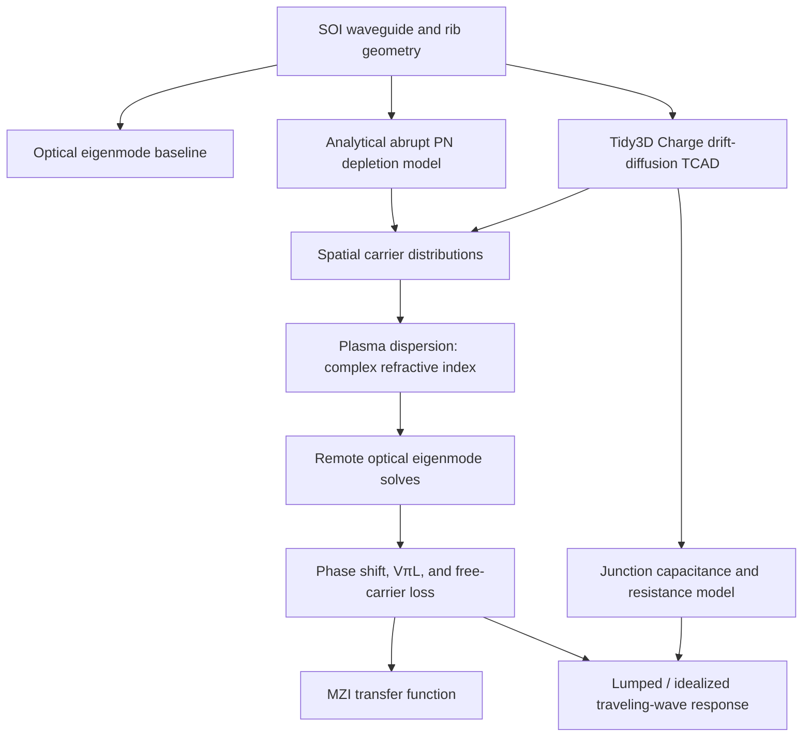

# High-Speed Silicon Photonic Mach–Zehnder Modulator

**Multiphysics design and simulation of a 1550 nm carrier-depletion Mach–Zehnder modulator (MZM) on silicon-on-insulator (SOI).** The project connects passive waveguide design, PN-junction carrier transport, plasma-dispersion-based optical modeling, MZI transfer characteristics, and circuit-level electrical bandwidth estimates.

**Tools:** Python · Tidy3D 2.12.0 (Charge/TCAD and optical eigenmode solvers)

> **Modeling scope:** The optical waveguide and carrier distributions were simulated; the traveling-wave electrode was evaluated with a circuit-level model, **not** an electromagnetic simulation of a designed electrode geometry. Reported optical losses exclude scattering, splitter/coupler loss, and metal absorption.

## At a glance

| Metric | Result | Basis |
|---|---:|---|
| Phase-shifter efficiency, $V_\pi L$ | **3.16 V·cm** | TCAD-informed optical mode model |
| Optical loss per $\pi$ phase shift | **0.78 dB** | Modeled free-carrier absorption only |
| Effective-index change at −4 V, $\Delta n_\mathrm{eff}$ | **$9.82\times10^{-5}$** (±2%) | Optical mode convergence study |
| MZI insertion loss / extinction ratio | **1.71 dB / 24.9 dB** | Modeled MZI, without unmodeled passive losses |
| Lumped-electrode 3 dB bandwidth | **4.3 GHz** | 50 Ω circuit model |
| Velocity-matched traveling-wave 3 dB bandwidth | **27.1 GHz** | Idealized circuit estimate; upper bound under omitted losses |

These are **simulation/modeling results, not measured device performance**. Assumptions and exclusions are listed in [Scope and limitations](#scope-and-limitations).

## Device and physical principle

A reverse-biased lateral PN junction depletes electrons and holes from the optical mode. The resulting free-carrier plasma-dispersion effect changes both the real and imaginary parts of silicon's refractive index. In an MZI, the electrically induced phase difference between the two arms controls the output intensity.

The main design tradeoff is among **modulation efficiency**, **optical loss**, and **electrical bandwidth**.

| Parameter | Design |
|---|---|
| Wavelength | 1550 nm |
| SOI device layer | 220 nm Si on buried oxide |
| Passive routing waveguide | 430 × 220 nm strip; single-TE-mode in the simulated design ($n_\mathrm{eff}=2.302$) |
| Active phase shifter | 500 × 220 nm rib; 90 nm slab, 130 nm etch |
| Junction | Lateral PN, offset +0.05 µm from rib center |
| Active doping | $N_A=N_D=1\times10^{17}\ \mathrm{cm}^{-3}$ |
| Heavily doped access regions | $1\times10^{19}\ \mathrm{cm}^{-3}$; 0.45 µm standoff from rib edge |
| Reverse-bias sweep | 0 to −4 V |

The narrower strip waveguide was chosen for passive routing, while the active rib geometry provides lateral conductive paths to the PN junction. **A strip-to-rib taper has not yet been simulated.**

## Modeling workflow

Two carrier models were evaluated on a common optical-modeling path:

1. **Analytical model:** abrupt-junction depletion approximation implemented in Python.
2. **TCAD model:** Tidy3D Charge drift-diffusion simulation; carrier fields interpolated onto the optical grid and converted to a spatially varying complex index using a plasma-dispersion model.

The same remote optical eigenmode procedure was applied to both carrier distributions. Their 0 V optical references agreed to eight digits, isolating the carrier-model dependence in their comparative results.

## Detailed results

*Nominal configuration: 0.45 µm access-region standoff, −4 V reverse bias. The optical convergence test used 120 steps per wavelength; circuit-level estimates are not optical-solver convergence results.*

| Quantity | Value |
|---|---:|
| $\Delta n_\mathrm{eff}$ | $9.82\times10^{-5}$ ±2% |
| $L_\pi$ | 7.89 mm |
| $V_\pi L$ | 3.16 V·cm |
| Modeled free-carrier absorption | 0.98 dB/cm |
| Modeled free-carrier loss per $\pi$ shift | 0.78 dB |
| Series resistance–length product, $R\cdot L$ | 1.48 Ω·cm |
| Junction capacitance per length | 0.069 pF/mm |
| Optical group index | 3.886 |
| Modeled MZI insertion loss / extinction ratio | 1.71 dB / 24.9 dB |
| Modeled MZI insertion loss with static $\pi$ offset | 1.23 dB |
| Lumped electrode, 50 Ω, 3 dB bandwidth | 4.3 GHz |
| Idealized velocity-matched traveling-wave, 3 dB bandwidth | 27.1 GHz |

## Engineering findings

### 1. Contact-region placement dominated optical-loss optimization

In one analyzed geometry, the heavily doped access regions contributed **5.69 of 7.67 dB/cm (74%)** of modeled free-carrier optical loss. This contribution was isolated by repeating the optical solve with the heavy access implants made optically transparent; the decomposition closed to within 0.3% in a separate check.

Moving access implants from **0.15 to 0.45 µm** away from the rib edge reduced modeled loss per $\pi$ shift from approximately **5.1 to 0.8 dB**, with roughly a **2% bandwidth penalty** in the corresponding model. The simulated lateral modal intensity followed approximately $\exp(-11.2y)$, with $y$ in µm (about 89 nm for a $1/e$ decay length). This explains why optical absorption falls sharply with separation even as access resistance rises more gradually.

### 2. MZI extinction is sensitive to arm-loss imbalance

Even with a calculated $\pi$ phase difference, the modeled MZI null was imperfect: reverse bias changes the driven arm's free-carrier absorption and therefore creates unequal amplitudes at the combining junction. A static $\pi$ phase offset in the idealized model shifts the operating condition so the null occurs at matched arm bias and the transmission maximum occurs in a lower-loss condition.

The **24.9 dB** result is limited by modeled free-carrier absorption asymmetry; it does **not** include splitter imbalance, fabrication variation, or other real-device imperfections. The static-offset case is an idealized design comparison, not a demonstrated physical extinction ratio.

### 3. Electrode loading, not intrinsic junction response, constrains the modeled bandwidth

The model estimates an **intrinsic junction RC limit of 417 GHz** under its series-resistance and junction-capacitance assumptions. With a 50 Ω external driver, however, lumped-electrode loading yields **4.3 GHz** bandwidth for the nominal $\pi$-shift design.

In the lumped model, the bandwidth–phase-shift product is approximately **13–18 GHz·rad**, showing why simply shortening or lengthening a lumped phase shifter does not solve the bandwidth/phase tradeoff. The **27.1 GHz** traveling-wave result assumes ideal velocity matching and omits conductor, contact, and other distributed losses; it should be read as a **model-based upper-bound estimate**, not a finished electrode prediction.

### 4. Junction position depends on the electrical drive model

The **+0.05 µm** junction offset gave the most favorable combined modulation-efficiency and loss result in the lumped study. A **+0.10 µm** offset was preferable in one modeled small-signal traveling-wave comparison: approximately **37% greater bandwidth** for **17% more loss**. As the depletion region extended toward the thinner slab, modeled junction capacitance dropped by about **28%**, reducing distributed RC loading.

### 5. TCAD and abrupt-junction models differ most at low bias

The TCAD-derived optical phase shift was **10–27% larger** than the abrupt-depletion approximation across the studied biases. The gap was largest at low reverse bias, where the gradual Debye-scale carrier transition omitted by the abrupt model represents a substantial share of the depletion width.

Under the modeled plasma-dispersion response at 1550 nm, holes contributed **3.85×** the index response of electrons in the comparison used. The associated ±50 nm alignment study gave a **1.2%** $\Delta n_\mathrm{eff}$ penalty in the p-ward direction versus **10.4%** in the n-ward direction. These are model- and operating-point-specific sensitivity results, not universal constants.

## Figures

The figures below should be placed in a `figures/` directory alongside this README. All numerical labels should retain their simulation settings and indicate whether a quantity is simulated, analytical, or estimated.

### Carrier-model comparison

### Contact-region optical-loss decomposition

### MZI transfer function

### Electrical bandwidth

**Additional figures:**

- [Loss per $\pi$ phase shift versus access geometry](figures/PhaseB_loss_over_Lpi.png)
- [Access-implant standoff: optical loss versus electrical resistance](figures/PhaseE_access_gap_tradeoff.png)
- [Junction-position and alignment sensitivity](figures/PhaseF_junction_position.png)

## Validation and numerical checks

- **TCAD charge mesh:** The Debye length is approximately **12.9 nm** at $10^{17}\ \mathrm{cm}^{-3}$. A 20 nm mesh failed to converge in the reported setup; 10 nm and 5 nm meshes placed depletion edges within about **1 nm**.
- **Optical-grid convergence:** Convergence was checked separately for the analytic geometry and for spatially varying carrier-derived media. A grid adequate for the former required approximately **4× refinement** for the latter.
- **Carrier and optical cross-check:** Depletion widths extracted from transport carriers and plasma-dispersion profiles agreed to approximately **1%**.
- **Capacitance:** TCAD capacitance agreed with the analytical reverse-bias depletion model to **2–7%**; independently calculated electron and hole capacitance values agreed to five significant figures, consistent with charge neutrality.

## Scope and limitations

- **Optical loss:** The reported loss and insertion-loss figures include modeled free-carrier absorption only, not sidewall scattering, roughness, metal absorption, splitter/coupler loss, or routing loss. They should not be interpreted as total fabricated-device insertion loss.
- **Electrical contacts:** Metal–semiconductor contact resistance was not included, so $R\cdot L$ is a lower-bound estimate and traveling-wave attenuation may be underestimated.
- **Electrodes:** Traveling-wave performance is calculated using a circuit-level model. No coplanar-waveguide (CPW) geometry or distributed electromagnetic field simulation has been completed, and conductor loss is excluded.
- **MZI idealizations:** Splitter imbalance, fabrication asymmetry, and phase-control errors are not modeled. Static-offset extinction predictions are especially idealized.
- **Integration:** The strip-to-rib transition taper was not simulated.
- **Polarization:** The 430 nm routing waveguide was checked for a single **TE** mode; the presence of a TM-like mode was not ruled out.

## Reproducing the work

The **notebooks/scripts in the repository are the computational record**. To reproduce the results:

1. Use **Python** with **Tidy3D 2.12.0**, plus the scientific Python packages imported by the notebooks (for example NumPy, SciPy, Matplotlib, and pandas as applicable).
2. Configure your **own** Flexcompute/Tidy3D API credentials locally. **Do not commit API keys or private configuration files.**
3. Run the passive optical, charge-transport, carrier-to-index conversion, optical phase-shifter, and circuit/MZI analyses in that order, following the notebooks' existing dependencies.
4. Compare regenerated curves and tables with the committed figures and values above. Charge and optical remote solves require Flexcompute access and may consume solver credits.

> **Reproducibility note:** Exact run instructions and a dependency lockfile should be added after checking the actual notebook filenames, imports, and execution order. The README intentionally does not invent filenames or claim a one-command reproduction pipeline.

## Next steps

- Explore asymmetric $N_A/N_D$ concentrations in light of the different electron and hole plasma-dispersion sensitivities.
- Quantify waveguide-width and slab-thickness fabrication tolerances.
- Design an actual traveling-wave electrode, including CPW cross section, impedance, microwave index, and conductor/contact loss, and solve its RF fields to replace idealized bandwidth bounds with device-specific predictions.

---

*Personal silicon photonics modeling project. All device figures and performance values are simulation- or model-derived unless explicitly labeled otherwise.*
