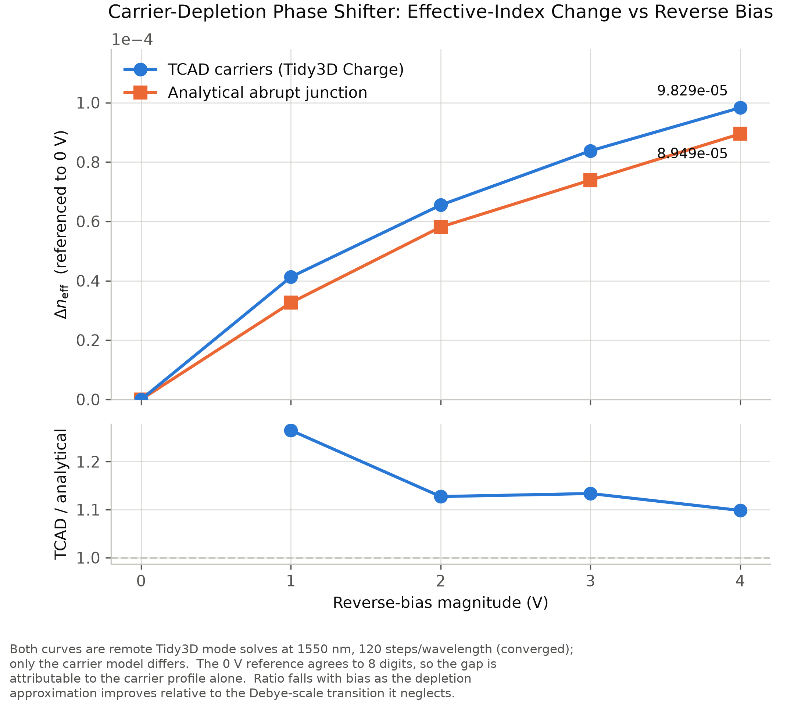
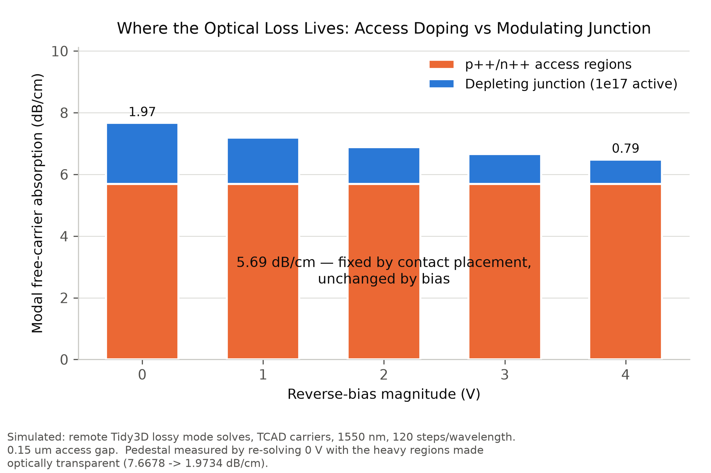
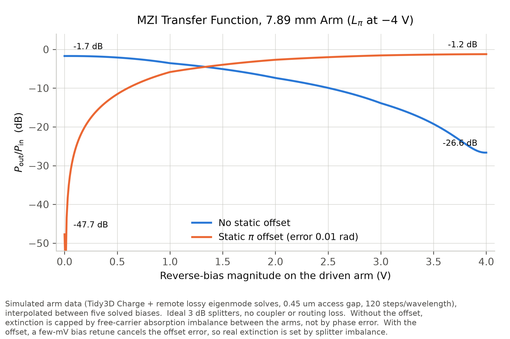
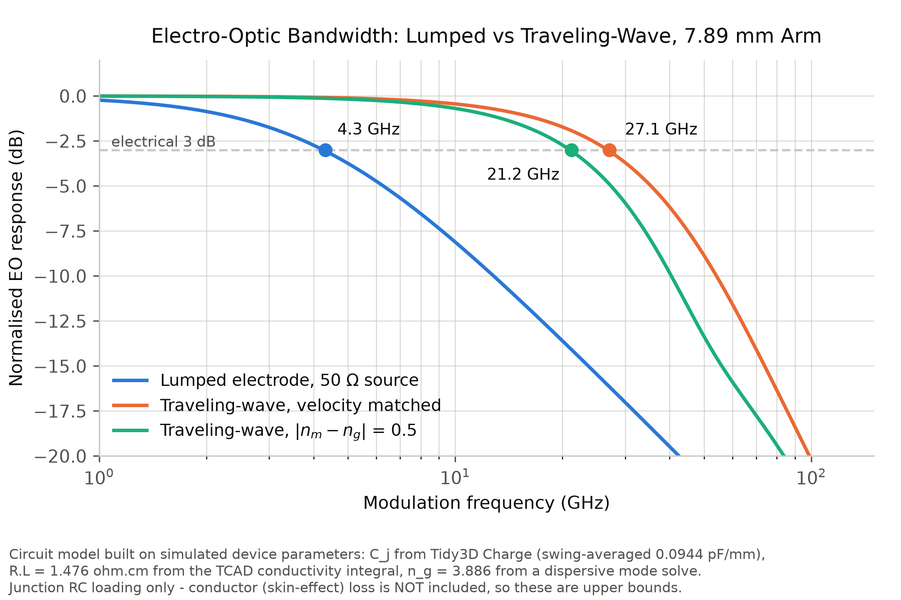

# High-Speed Silicon Photonic Mach–Zehnder Modulator

Design and simulation of a **1550 nm carrier-depletion Mach–Zehnder modulator (MZM)** on a silicon-on-insulator (SOI) platform. I used Python and **Tidy3D 2.12.0** to model the waveguide, PN-junction carrier distributions, optical phase shift and loss, and the resulting MZI response. I also compared lumped and traveling-wave drive using circuit-level models.

The goal was to understand the tradeoffs between **modulation efficiency, optical loss, and bandwidth**, rather than just calculate a single $V_\pi L$ value.

## Results at a glance

| Metric | Result |
|---|---:|
| Phase-shifter efficiency, $V_\pi L$ | **3.16 V·cm** |
| Free-carrier loss per $\pi$ phase shift | **0.78 dB** |
| Effective-index change at −4 V, $\Delta n_\mathrm{eff}$ | $9.82\times10^{-5}$ (±2%) |
| Modeled MZI insertion loss / extinction ratio | 1.71 dB / 24.9 dB |
| Lumped-electrode bandwidth (50 Ω) | 4.3 GHz |
| Idealized traveling-wave bandwidth | 27.1 GHz |

*All values are from simulations or analytical/circuit models, not measurements. The optical loss figures include free-carrier absorption only; the traveling-wave result does not include a simulated RF electrode geometry.*

## Device design

| Parameter | Design |
|---|---|
| Wavelength | 1550 nm |
| SOI silicon thickness | 220 nm |
| Passive waveguide | 430 × 220 nm strip ($n_\mathrm{eff}=2.302$ for TE$_0$) |
| PN phase shifter | 500 × 220 nm rib, 90 nm slab |
| Junction | Lateral PN, +0.05 µm offset |
| Junction doping | $N_A=N_D=10^{17}\ \mathrm{cm}^{-3}$ |
| Access implants | $10^{19}\ \mathrm{cm}^{-3}$, 0.45 µm from the rib edge |
| Reverse bias | 0 to −4 V |

I used a narrower strip waveguide for passive routing and a rib for the active section so that the PN junction has a conductive path to the contacts. The transition between the two has not been simulated yet.

## Simulation approach

The core workflow was:

1. Solve the passive waveguide modes and choose the strip/rib dimensions.
2. Calculate carrier distributions using both a Python **abrupt-junction depletion model** and the **Tidy3D Charge drift-diffusion solver**.
3. Convert the electron and hole distributions into a spatially varying complex refractive index using plasma dispersion.
4. Run optical eigenmode solves to extract $\Delta n_\mathrm{eff}$, absorption, and $V_\pi L$.
5. Use those results to model the MZI transfer function and estimate electrical bandwidth.

Both carrier models went through the same optical solve, making it possible to compare the analytical approximation directly against TCAD. Their 0 V optical references matched to eight digits.

## Figures

### Analytical depletion model vs. TCAD

TCAD predicted **10–27% more phase shift** than the abrupt-junction model, especially at low reverse bias. The main difference comes from the gradual carrier transition near the depletion edge, which the abrupt model ignores.

### Where the optical loss comes from

For one geometry, the heavily doped access implants accounted for **5.69 of 7.67 dB/cm (74%)** of modeled free-carrier loss. Increasing the implant standoff from 0.15 to 0.45 µm reduced loss per $\pi$ shift from about **5.1 to 0.8 dB**, with a much smaller electrical penalty in the model.

### MZI transfer function

The MZI does not reach a perfect null just because the differential phase reaches $\pi$: the reverse-biased arm also has a different absorption level. I explored a static phase offset to improve amplitude matching in the idealized MZI model.

### Electrical bandwidth

The intrinsic junction RC estimate is **417 GHz**, but adding a 50 Ω driver limits the nominal lumped phase shifter to **4.3 GHz**. An idealized velocity-matched traveling-wave model gives **27.1 GHz**, illustrating why electrode design matters for high-speed operation.

More plots: [loss per $\pi$ shift](Figures/PhaseB_loss_over_Lpi.png) · [implant standoff tradeoff](Figures/PhaseE_access_gap_tradeoff.png) · [junction-position sensitivity](Figures/PhaseF_junction_position.png)

## Other findings

- **Junction position matters:** +0.05 µm gave the best balance in the lumped model, while +0.10 µm improved bandwidth by about 37% in a small-signal traveling-wave comparison, at the cost of 17% more optical loss.
- **The design is sensitive to implant alignment:** A ±50 nm shift had an asymmetric effect on phase efficiency because the electron and hole contributions to plasma dispersion differ.
- **Mesh convergence needs separate checks:** A 20 nm charge mesh did not converge in the tested setup, while 10 nm and 5 nm meshes agreed to about 1 nm on depletion-edge location. The spatially varying optical-index model also needed a finer grid than the analytical model.

## Notebooks

| Notebook | Contents |
|---|---|
| [01 — Strip waveguide mode](Notebooks/01_strip_waveguide_mode.ipynb) | Initial SOI waveguide eigenmode analysis |
| [02 — Waveguide width sweep](Notebooks/02_waveguide_width_sweep.ipynb) | Width sweep and mode selection |
| [03 — PN phase shifter](Notebooks/03_PN_phase_shifter.ipynb) | Depletion model, TCAD, optical mode solves, MZI and bandwidth calculations |

The notebooks contain the calculations behind the plots and reported results. They use Python, Tidy3D 2.12.0, and scientific Python packages such as NumPy, SciPy, and Matplotlib. Remote Tidy3D solves require a configured Flexcompute API key and may use solver credits.

## Limitations and next steps

This is a **simulation project**, not a fabricated or measured device. The current model excludes sidewall scattering, coupler loss, metal absorption, and contact resistance. The traveling-wave bandwidth is a **circuit-level estimate**, not a prediction from a designed and electromagnetically solved CPW electrode. The strip-to-rib taper and fabrication variability also remain to be modeled.

Next I want to investigate asymmetric PN doping, waveguide and slab-thickness tolerances, and a full traveling-wave electrode design including impedance, velocity matching, and RF loss.
